<picture>
  <source media="(prefers-color-scheme: dark)" srcset="assets/hero-dark.svg">
  
</picture>

<a href="https://www.linkedin.com/in/shovalbb/">
  <picture>
    <source media="(prefers-color-scheme: dark)" srcset="assets/btn-linkedin-dark.svg">
    
  </picture>
</a>

I work where financial products meet data, at **KPI-FIN** in Israel.
Day to day I lead the team's internal products. The rest of the time I build the tooling that lets AI agents ship real, reviewed work.

<picture>
  <source media="(prefers-color-scheme: dark)" srcset="assets/focus-dark.svg">
  
</picture>

### Now

- **kpiOS** is where most of my commits go. It runs an 8-person team's hours, tasks, presence, budgets and quotes, in Hebrew RTL and mobile-first, on the *Flow by KPI* design language this page borrows from.
- **Agent-first workflow**: specs, plans and change notes live next to the code, CI checks them, and every PR is reviewed before it merges.
- **Legacy to modern**: moving financial logic from VBA and spreadsheets into typed, tested code.

<picture>
  <source media="(prefers-color-scheme: dark)" srcset="assets/stack-dark.svg">
  
</picture>

<code>shoval · building with AI and for AI</code>

